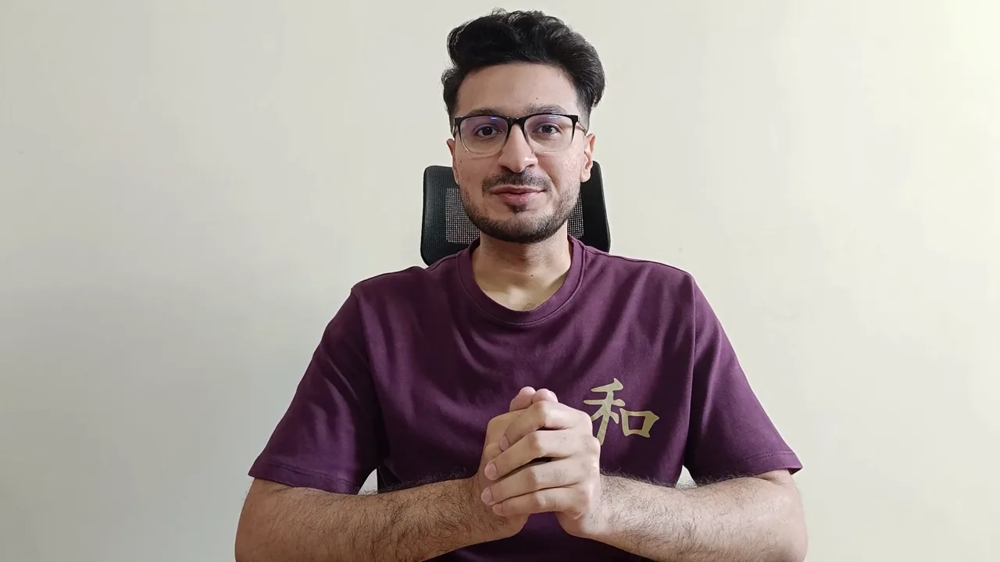

# Daniyal Khalid

Senior full-stack engineer in Lahore, Pakistan (UTC+5). I fix and ship MVPs that break under real users, for funded founders and for design agencies that need the app behind a Figma file.

**Get a free build audit:** [daniyalk.com](https://daniyalk.com) · [LinkedIn](https://www.linkedin.com/in/daniyalk-dev) · hello@daniyalk.com

▶ [Watch my 75-second intro](https://youtu.be/PYnsktslrhs)

**Experience:** 5+ years shipping production software, including 3+ years building products remotely for Etra Ventures, a UK venture studio. Previously Khaleef Technologies and ArhamSoft in Lahore.

## What I do

- **Rescue sprints** for stalled builds made with Cursor, Lovable, v0, Bolt or a junior team: audit the code, fix the blocking bugs, harden auth and row-level security, and deploy properly with CI
- **MVP sprints** from a Figma file or a spec: Next.js and TypeScript on Supabase/Postgres, with auth, data model, core flows and analytics
- **Fractional senior engineer**, 10 or 20 hours a week

## Selected work

Most of my production work lives in private employer and client repositories, so here is what it was:

- **Foodie** ([foodie.app](https://foodie.app)): lead developer from the first commit to production. Next.js 16, TypeScript and Supabase, with video extraction, embeddings and Places sync in a separate Fastify worker on AWS ECS, provisioned with Terraform.
- **SuperViral** ([superviral.io](https://superviral.io)): owned the customer-facing front end of a social-commerce product with tens of thousands of monthly users. The live site has since been redesigned by another team.
- **Almo** ([almo.app](https://almo.app)): built the entire React 19 and TypeScript front end of a breathing and journaling app.
- **Cricwick** ([cricwick.net](https://cricwick.net)): designed and shipped the Next.js and MySQL headless CMS behind the site, still in production.

## Stack

Next.js · React · TypeScript · Node.js · Fastify · Supabase · PostgreSQL · MySQL · Tailwind CSS · Docker · AWS (ECS, Lambda, S3) · Terraform · Vercel

## How I work

A written scope before anything starts. Fixed price and dates. Async by default, with a short video update every 48 hours. You own the repo, hosting and accounts from day one.
